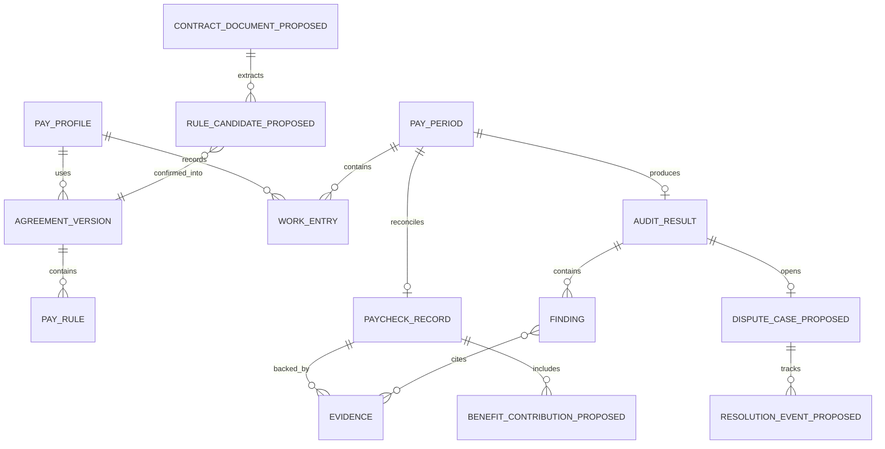
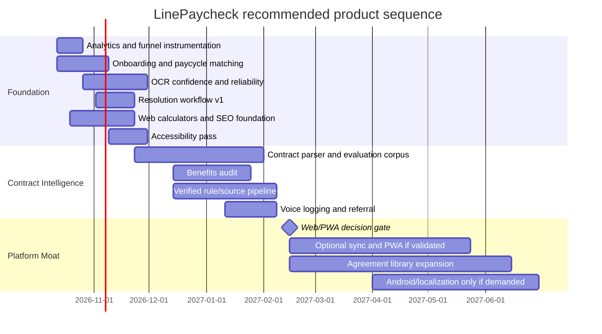

# LinePaycheck: Product, Repository, Competitive Landscape, and Path to the #1 Lineman Pay App

## Executive summary

LinePaycheck already has a stronger technical foundation than a typical early-stage trade-pay app. The repository contains a deterministic Swift payroll engine, effective-dated agreement/rule support, detailed work logging, callout and per-diem handling, paycheck reconciliation, on-device OCR, evidence capture, report generation, local-first storage, explicit backup/restore, StoreKit subscriptions, extensive unit/UI tests, and unusually serious legal/correctness guardrails. The codebase is not an MVP calculator; it is already the beginnings of a **pay-verification system**. fileciteturn5file0L5-L21 fileciteturn6file0L2-L18

The competitive threat is nevertheless real. **LineLedger currently has the clearest feature advantage**: it imports the worker's labor agreement, answers contract questions, audits pay **and benefits**, supports date-effective rules, accepts paystubs/NEAP statements/foreman time sheets, and offers voice logging. It costs only **$59.99/year or $7.99/month**. Its App Store positioning is unusually concrete: “upload your labor agreement → log hours → check pay and benefits.” citeturn5search1

**Union Line Calls has the strongest recurring distribution loop**. It combines outside-line job calls, book movement, local wage/OT rules, per-diem information, alerts, and a pay calculator. Journeyman access is $99/year or $9.99/month with a seven-day trial. More importantly, workers can have a reason to open it before they even have a payroll problem. citeturn5search3turn5search5turn6view1

**TrampHereBro owns a useful free-search/discovery wedge**: its web calculator lets a lineman enter hours, overtime and per diem and rank IBEW locals by take-home wages or total package, while its Pay Map exposes wage-package data without requiring an account. citeturn6view0turn5search13 **FlexTime attacks the bottom of the market with a free, open-source, offline browser app** covering overtime, double time, deductions, per diem and printable monthly reports. citeturn5search0

The strategic implication is important:

> **Do not try to become Union Line Calls + LineLedger + a timesheet app + a union directory all at once. Make LinePaycheck the trusted system that answers one high-value question better than anyone else: “Was this paycheck correct under the rules that actually apply to me, and what evidence do I need if it wasn't?”**

The winning product loop should become:

**Agreement → confirmed rules → work record → expected pay → paycheck scan → discrepancy explanation → source evidence → resolution → next payday.**

That requires four major moves, in this order:

| Priority | Move | Why it matters |
|---|---|---|
| **P0** | Fix activation, measurement, pay-period matching and OCR reliability | You cannot optimize a 5% install-to-paid target without knowing exactly where users fail |
| **P0** | Launch free web lineman/storm/callout calculators | Lowers blended CAC and gives LinePaycheck a distribution surface competitors cannot gate through the App Store |
| **P1** | Contract PDF → cited, user-confirmed pay rules | Neutralizes LineLedger's biggest product advantage while preserving LinePaycheck's deterministic-calculation moat |
| **P1** | Benefits audit + discrepancy-resolution workflow | Moves the product from “calculator” to “money recovery/evidence workflow,” where willingness to pay should be materially higher |

I would **not** prioritize shared team accounts, a full PWA, Android parity, a job-call marketplace, or broad localization yet. Those are expensive expansions before the core economic loop has been proven.

There is also an immediate unit-economic warning. At the repository's canonical **$79.99/year** price, a **$4 CPI and 5% install-to-paid conversion means $80 CAC per subscriber**—already slightly greater than the entire first-year gross subscription price, before App Store commission, support, refunds or operating costs. The repository currently specifies $9.99/month, $79.99/year, a seven-day annual trial, and one complete free paycheck audit. fileciteturn8file0L2-L45

At a hypothetical $99/year price, 5% conversion produces $80 CAC against $99 gross revenue; under a 15% platform-fee assumption, first-year receipt is $84.15, leaving only **$4.15 before every other cost**. Therefore:

**5% is a plausible conversion objective, but it is not a healthy scaling objective at $4 CPI.**

For paid acquisition, I would target either **7–8%+ install→paid at ~$99/year**, or drive blended CPI materially below $4 through web/SEO/referral distribution. More important than either target is proving second-paycheck usage and annual renewal.

My confidence in the product-direction conclusion is **high**. Confidence in exact growth targets and engineering durations is **medium**, because there is not yet cohort data, production funnel analytics, OCR corpus performance, renewal data, or user-interview evidence in the material audited.

## Repository audit

### Audit scope and architecture

I could not perform a network `git clone` in the execution environment, so I did not pretend to have run a fresh local build. Instead, I inspected the repository through the connected GitHub API: the complete recursive `main` tree and targeted source, architecture, product, CI, release and research files. The audited tree is at SHA **`11d922745944db67c49e1d3c2309bda1a55b2dc6`** and contains the iOS app, domain package, tests, Maestro journeys, store assets, user guide, CI workflows and product/legal documentation. fileciteturn21file0L2-L2

The architecture decision is explicitly **local-first, no LinePaycheck account and no central backend containing worker pay data**. Payroll calculations and document processing are intended to occur on-device; StoreKit handles subscriptions. fileciteturn6file0L2-L18 fileciteturn6file0L61-L92

That is not merely a technical choice. It is an important competitive position. LineLedger's cloud-AI mode sends contract text and pay data to its AI provider, although it also advertises an on-device model option. citeturn5search1 LinePaycheck can credibly position itself around **deterministic local computation + explicit provenance + optional AI only at the document-understanding boundary**.

### Existing feature inventory

| Area | Existing implementation | Assessment |
|---|---|---|
| Onboarding | Welcome flow, pay profile setup, onboarding paywall, first-result flow | **Implemented** |
| Pay profile | Configured wages/rules, effective-dated agreement machinery | **Strong foundation** |
| Work logging | Add work, repeat work, callout workflow, exact time intervals, breaks/timezone context | **Implemented** |
| Pay engine | Base wages, daily tiers, weekday/date/off-schedule premiums, callout guarantees, per diem, bounded weekly regular-rate calculations | **Sophisticated but intentionally scoped** |
| Pay periods | Start period, ledger, historical periods | **Implemented; payroll-schedule abstraction should be improved** |
| Paystub intake | Camera/document scanning, import, OCR, parser, field confirmation | **Implemented** |
| Paycheck audit | Gross/line/hours reconciliation, not-comparable/review states, discrepancy presentation | **Core differentiator already exists** |
| Evidence | Original-document retention, source evidence, receipts/provenance | **Strong** |
| Reports | Reconciliation report exporter, share workflow, temporary exports | **Implemented** |
| History | Pay ledger + History screen | **Implemented** |
| Backup/recovery | Manual Files/iCloud Drive backup and restore, validation and recovery UI | **Implemented** |
| Subscription | StoreKit Pro, restore behavior, monthly/annual, annual trial, first audit free | **Implemented** |
| Offline/privacy | Core app works without account or LinePay backend | **Strong differentiator** |
| Web | Hugo user guide/static content | **Documentation, not a product/PWA/calculator** |
| Android | Directory/placeholder exists but no comparable production Android implementation | **Not built** |
| Localization | String-catalog infrastructure exists, but current product is effectively English-first | **Gap** |
| Product analytics | No meaningful first-party analytics architecture surfaced in the current local-first tree | **Critical business gap** |

The payroll-coverage documentation itself is appropriately conservative. It explicitly says the system models exact work instants, configured wages and daily tiers, various premiums, effective-dated rules, isolated callout minimums, flat per diem, paycheck comparison and a restricted weekly regular-rate layer—but does **not** claim universal federal/state/CBA completeness. fileciteturn5file0L5-L20

The explicit unsupported or incompletely verified areas include broader federal weekly-overtime applicability, bonuses/differentials and retroactive adjustments, state/local/public-agency rules, full CBA interactions, prevailing-wage/fringe projects, travel/standby/show-up/non-work paid time, taxes, net deductions, penalties and recovery claims. fileciteturn5file0L21-L55

That restraint should remain part of the product architecture. The route to #1 is **not pretending to understand every union contract automatically**. It is making unsupported conditions highly visible and progressively expanding verified coverage.

### Screens and user-facing flows

The current SwiftUI tree includes approximately two dozen explicit views, among them:

`TodayView`, `AddWorkView`, `RepeatWorkView`, `StartPayPeriodView`, `PayLedgerView`, `PayProfileSetupView`, `WeeklyOvertimeReviewView`, `PaystubImportView`, `DocumentScannerView`, `AuditDetailView`, `AuditStatusView`, `EvidenceReceiptView`, `SourceEvidenceView`, `HistoryView`, `ReportSharingView`, `BackupRestoreView`, `DataRecoveryView`, `SettingsView`, `OnboardingWelcomeView`, `OnboardingPaywallView`, and `FirstPayResultView`. fileciteturn21file0L2-L2

That breadth is both an asset and a warning. This is already complex enough that the next competitive advantage is unlikely to come from adding twenty more screens. **Reducing cognitive load around first value is probably higher leverage than increasing raw surface area.**

### Data model and calculation kernel

The domain package is separate from UI/application code and contains dedicated modules for agreement timelines, provenance, money/decimal handling, pay calculation, paycheck assessment, reconciliation, weekly regular-rate logic and work templates. fileciteturn21file0L2-L2

Conceptually, today's product and the proposed extensions should converge on this model:



The critical architectural principle is that **AI should feed the deterministic engine, never replace it**.

A contract parser should therefore produce:

`contract PDF → extracted clause → candidate structured rule → clause/page citation → confidence → user confirmation → AgreementVersion → deterministic PayCalculator`

—not:

`contract PDF → LLM → "you are owed $3,412.17"`

That distinction is one of LinePaycheck's most defensible potential advantages.

### APIs, dependencies and build/test/deploy

The runtime is intentionally light on external dependencies. The XcodeGen configuration targets **iOS 18**, **Swift 6**, strict concurrency and warnings-as-errors. The application depends on the local `LinePayDomain` package; `ViewInspector` is pinned for tests rather than being a core runtime dependency. fileciteturn9file0L2-L34 fileciteturn9file0L36-L95

Apple/platform dependencies include StoreKit for subscription ownership, Vision/VisionKit for on-device document/OCR processing, the Files/share system for user-controlled data movement, and normal SwiftUI/iOS frameworks. The architecture explicitly rejects a LinePay-specific API/backend for current payroll processing. fileciteturn6file0L61-L92

The test surface is substantially better than most apps this young:

- Domain-level tests cover pay calculations, boundaries, agreement timelines, weekly regular-rate logic and California fixtures.
- App tests cover OCR parsing, StoreKit lifecycle, backup validation/concurrency, reconciliation/report flows, legal regressions and screen contracts.
- UI tests cover payday and legal journeys.
- Maestro flows exercise onboarding, paycheck auditing, work lifecycle, rule scope, backup consent and adaptive layout. fileciteturn21file0L2-L2

CI uses a dedicated `linepay-ios` runner, Xcode 26.6, a release simulator and pinned XcodeGen, with the workflow's comments reporting roughly a 20+ minute complete gate on the current Mac mini. fileciteturn10file0L2-L55

This is a meaningful advantage: **payroll correctness requires regression fixtures, not merely visual QA**.

### Technical debt and privacy/security audit

The largest code-level maintainability signal is the concentration of orchestration in `AppModel.swift`—roughly 73 KB in the audited tree—alongside a sizable `AppState` and many view-specific adapters. fileciteturn21file0L2-L2 I would not launch an abstract “clean architecture rewrite,” but new contract, benefits and dispute domains should **not** be added by continuing to grow one central model. Extract those capabilities behind repositories/use cases as they are introduced.

There is also documentation drift worth fixing. The older local-first architecture diagram describes persistence as SwiftData, while the active source tree contains a dedicated `LocalStateStore.swift` and explicit versioned archive/state logic. fileciteturn6file0L19-L60 fileciteturn21file0L2-L2 The documentation should accurately represent the shipping persistence mechanism before sync or multi-device work begins.

The current privacy posture is structurally good: no account requirement, no central LinePay pay database and on-device document processing. fileciteturn6file0L2-L18

The most concrete security issue I found is the backup format. A `.linepaybackup` can contain the profile, agreement versions, work, notes, audit revisions, confirmed paystub fields and original paystub documents; the archive uses a SHA-256 integrity digest but **is explicitly not password-encrypted by LinePaycheck**. fileciteturn7file0L2-L48

That is acceptable only because it is explicit and user-controlled, but a future **encrypted backup option / Face ID app lock** is worthwhile once the core product loop is stronger.

More important: adding cloud contract AI or analytics changes the current privacy boundary. Any such feature should have:

1. explicit opt-in;
2. no document/pay-data use for provider model training;
3. documented retention/deletion;
4. minimal redacted payloads where possible;
5. local/on-device alternative where feasible;
6. updated privacy manifest, App Store disclosure and policy;
7. absolutely no silent telemetry of wages, employers, union membership, document contents or dispute amounts.

## Competitive landscape

### Benchmark

Legend: **●** strong/explicit capability; **◐** partial; **○** not publicly advertised.

| Capability | LinePaycheck | LineLedger | Union Line Calls | FlexTime | TrampHereBro |
|---|---:|---:|---:|---:|---:|
| Work logging | ● | ● | ○ | ● | ○ |
| Deterministic configurable pay engine | **●** | ◐ AI/contract-driven | ● local wage/OT estimates | ● simpler rules | ◐ scenario calculation |
| Paystub OCR/import | **●** | ● upload/audit | ○ | ○ | ○ |
| Contract PDF interpretation | ○ | **●** | ○ | ○ | ○ |
| Contract Q&A | ○ | **●** | ○ | ○ | ○ |
| Paycheck reconciliation | **●** | ● | ○ | ○ | ○ |
| Benefits audit | ○ | **●** | ○ | ○ | ◐ package estimates |
| Effective-dated rules | ● | **● advertised** | ◐ | ○ | historical/current source data |
| Callout/per diem | ● | ● | per-diem/job data | per diem | per diem |
| Evidence/report export | **●** | ◐ | ○ | monthly report/PDF | ○ |
| Resolution/dispute workflow | ◐ report only | ○ publicly advertised | ○ | ○ | ○ |
| Voice work entry | ○ | **●** | ○ | ○ | ○ |
| No account | **●** | **●** | No, verified account | **●** | Map/calculator no account |
| Offline/local-first | **●** | ● local option | web/account | **●** | web |
| Full web utility | Documentation only | ○ | **●** | **●** | **●** |
| Job calls/book status | ○ | ○ | **●** | ○ | adjacent board/content |
| Local wage discovery | ○ | ○ | **●** | ○ | **●** |
| Spanish surface | ○ | ○ | not highlighted | ○ | **● calculator toggle** |
| Current annual price | **$79.99 repo strategy** | **$59.99** | **$99** | **Free** | **Free calculator/map** |
| Current monthly price | $9.99 | $7.99 | $9.99 | Free | Free |

LinePaycheck pricing comes from the repository's canonical commercial specification. fileciteturn8file0L2-L45 LineLedger's current App Store listing shows $59.99/year and $7.99/month and describes its contract, benefits, voice and AI functionality. citeturn5search1 Union Line Calls publishes $99/year/$9.99 monthly with a seven-day trial. citeturn5search3turn5search5 FlexTime is free/open-source and browser-based. citeturn5search0 TrampHereBro's map/calculator are free public acquisition surfaces. citeturn5search13turn6view0

### What each competitor is actually teaching you

**LineLedger is the product-threat benchmark.** Its important idea is not “AI chat.” It is **contract-specific context**. Its App Store copy says the worker can upload an agreement, paystubs, NEAP statements and foreman time sheets; the app answers questions about overtime, per diem, travel, meal penalties and classifications, and audits both wages and benefits using the rate effective on the worked dates. It also advertises voice input and large field-friendly controls. citeturn5search1

Copying its AI implementation would be a mistake. LinePaycheck should instead exceed it on **auditability**: every extracted rule should have a clause, page, effective date and confirmation state feeding a deterministic engine.

**Union Line Calls is the distribution benchmark.** Workers have reasons to use it while deciding where to go to work, not just after something goes wrong. Its member product combines call data, book status, hall information, contract scales, OT rules, favorites and alerts. citeturn5search3turn5search5 Its public website also creates a large indexable information surface around outside-line work. citeturn6view1

Do **not** respond by building another job-call network. That market has substantial data-maintenance and network-distribution costs. Instead, make LinePaycheck interoperable with the worker's wage/job context and attack the **verification problem**.

**FlexTime is the “good enough for free” benchmark.** It handles ST/OT/DT, deductions, per diem, offline browser storage, backups and printable reports without an account or subscription. citeturn5search0 Therefore LinePaycheck cannot charge $80–$100/year merely for time logging and overtime arithmetic. The paid value must be **verification, contract intelligence, evidence and resolution**.

**TrampHereBro is the SEO/product-led acquisition benchmark.** Its calculator asks for hours, overtime rate, per diem and home local, then ranks IBEW locals; it includes a specific IBEW Lineman mode. citeturn6view0 Its Pay Map exposes local wage packages, recorded-date freshness and schedule-based earnings estimates publicly, with no account. citeturn5search13 This is close to the acquisition model LinePaycheck should emulate.

### Visual references and demos

The most reliable visual references I found are the official/product-controlled pages rather than third-party screenshot scrapers:

| Product | Visual/product reference |
|---|---|
| LinePaycheck | [Official App Store page](https://apps.apple.com/us/app/linepaycheck-lineman-pay/id6808889292) |
| LinePaycheck repo | [Versioned App Store screenshot directory](https://github.com/RunLumi/linepay/tree/main/assets/store/exports/ios/1.0.5/en-US/6.5) |
| LineLedger | [Official App Store screenshots](https://apps.apple.com/us/app/lineledger-lineman-pay/id6776469707) citeturn5search1 |
| Union Line Calls | [Official public product](https://www.unionlinecalls.com/) and member app linked from it citeturn6view1 |
| FlexTime | [Official product/live-demo page](https://emmausdev.com/flextime) citeturn5search0 |
| TrampHereBro | [Pay Calculator](https://www.trampherebro.com/calculator) and [Pay Map](https://www.trampherebro.com/paymap) citeturn6view0turn5search13 |

I did **not** find a verified official LineLedger product walkthrough video in the indexed material reviewed, so I would not use an unverified repost as competitive evidence.

## Feature gaps and product strategy

### The important gap is not “more features”

The market currently separates into three buckets:

1. **Free/simple math:** FlexTime and generic calculators.
2. **Work opportunity/wage discovery:** Union Line Calls and TrampHereBro.
3. **Contract-aware verification:** LineLedger is moving here.

LinePaycheck should own a fourth, stronger category:

> **Evidence-backed payroll verification for lineworkers.**

That turns the product from a calculator into a trusted workflow.

### Priority gap map

| Requested capability | Current state | Competitive importance | Recommendation | Priority |
|---|---|---:|---|---:|
| Paystub OCR | **Already implemented** | High | Improve confidence, layout coverage, multi-page handling and field provenance rather than rebuild it | **P0** |
| Contract/union rule parsing | Missing | Very high; LineLedger advantage | PDF → cited candidate rules → human confirmation → deterministic engine | **P1** |
| Dispute/resolution workflow | Reports exist, workflow incomplete | **Very high** | Add case/status/evidence packet/resolution history | **P0** |
| Multi-paycycle support | Pay periods exist; dedicated employer-cycle model unclear | High | Weekly/biweekly/semi-monthly/custom cycle + statement matching | **P0** |
| Benefits audit | Missing | High; LineLedger advantage | Model pension/annuity/H&W/fringe contributions separately from wages | **P1** |
| Team/shared accounts | Missing intentionally | Low for core persona | Start with shareable rule templates, not shared personal payroll | **P2** |
| Offline mode | **Core existing architecture** | High | Preserve | **Keep** |
| Web PWA | Missing | Medium | Calculator first; full PWA only after web demand proves itself | **P2** |
| SEO calculator | Missing | **Very high acquisition leverage** | Free no-signup lineman/storm/callout calculators | **P0** |
| Analytics | Essentially absent by design | **Critical business need** | Privacy-minimal funnel telemetry containing no payroll content | **P0** |
| Referral/affiliate | Missing | High | Creator/referral attribution after conversion instrumentation | **P1** |
| Pricing experiments | Limited/simple current plan | High | Keep simple; test price/paywall only after event instrumentation | **P0** |
| Trials | Seven-day annual trial exists | High | Optimize trigger/timing, not simply duration | **P0** |
| Localization | English-first | Medium | Spanish after US product loop works; French if Canada becomes material | **P2** |
| Accessibility | Test/layout infrastructure exists; complete accessibility certification unclear | High | VoiceOver, 200% Dynamic Type, contrast, Reduce Motion, 48pt field controls | **P0** |
| Security/compliance | Strong legal architecture, local-first | Critical | Encrypt optional backups, strict cloud-AI boundary, keep provenance/abstention | **P0 baseline** |
| Voice logging | Missing | Medium/high field UX | Native voice-to-structured-work-entry with confirm step | **P1** |
| Local wage/rule database | Missing | High distribution/value | Verified-source rule packs, not unsourced crowdsourcing | **P1** |
| Job calls | Missing | Already served well elsewhere | Partner/link; do not build initially | **Do not prioritize** |

### The strongest differentiators to build

#### Contract-to-rule ingestion

This is the single most strategically important product feature after the core funnel is fixed.

UX:

**Upload agreement → LinePaycheck identifies candidate rules → user sees clause/page next to each rule → Confirm / Edit / Not applicable → rules become an effective-dated agreement version.**

Supported schema should begin narrowly:

- base wage/classification;
- daily and weekly OT thresholds;
- double-time conditions;
- Sunday/holiday premium;
- callout/show-up minimum;
- per diem/subsistence;
- shift differential;
- missed-meal premium where explicitly supported;
- effective dates;
- benefits contribution rates.

The model must **abstain** when it cannot map a clause safely.

Acceptance criteria:

- No AI-derived rule can become active without an explicit confirmation.
- Every suggested rule includes document/page provenance.
- Effective dates must be captured or flagged unresolved.
- Conflicting clauses generate review, not arbitrary selection.
- High-confidence suggestions should target **≥98% precision on the supported-rule evaluation corpus**; low-confidence cases should abstain.
- The deterministic engine remains solely responsible for dollar calculations.

#### Benefits audit

LineLedger has already identified a serious gap: lineworker compensation is larger than the cash wage. Its listing explicitly calls out NEAP and Lineco-type pension/annuity and H&W contributions. citeturn5search1

The product model should separate:

`Cash earnings`  
`Allowances/per diem`  
`Employer-paid benefit contributions`  
`Employee deductions`  
`Unsupported/unverified items`

Do not collapse benefits into "gross pay."

A future audit result could say:

> Wage comparison: no material difference detected  
> NEAP contribution: possible 4.5-hour difference  
> H&W: could not verify — statement missing

That is far more credible than one universal red/green paycheck verdict.

#### Paycheck resolution workflow

Today the product can generate and share reconciliation reports. The next step is to make the workflow longitudinal:

**Possible difference → Review evidence → Prepare question → Shared → Employer/union response → Resolved / corrected / explained.**

Do not label everything a “claim” or “wage theft.” Preserve the repo's conservative product/legal posture. The payroll coverage documentation already correctly stops unconditional verdicts where material rules or inputs are incomplete. fileciteturn5file0L43-L55

This feature can create a powerful retention loop: a user remembers the app not because it showed a number, but because **it helped resolve a real paycheck discrepancy**.

#### Paystub OCR v2

OCR already exists; its own coverage documentation explicitly warns that correct extraction of every employer's layout is not established and OCR suggestions still require confirmation. fileciteturn5file0L21-L24

Therefore the right improvement is **trustworthy extraction**, not “AI OCR.”

Each field should visibly carry:

- extracted value;
- confidence;
- source bounding area;
- recognized label;
- original image/page;
- confirmation/edit status.

Measure **field-edit rate by paystub format**, not merely “OCR succeeded.”

#### Local wage/rule source layer

TrampHereBro and Union Line Calls demonstrate that wage/local information is valuable for acquisition. citeturn5search5turn5search13

LinePaycheck should eventually have a source-backed rule-pack architecture:

> IBEW Local X → agreement/rate source → effective date → date verified → supported rules → unsupported clauses → source link.

The moat is not owning wage numbers. Those can be copied.

The moat is:

**source + effective date + structured rule + deterministic result + user's real work + real paystub + resolution outcome.**

That dataset becomes increasingly difficult for a generic calculator or AI chatbot to reproduce.

## Prioritized roadmap

### Roadmap principles

The roadmap should be gated by evidence, not calendar ambition:

**First prove activation → then improve verification → then add contract intelligence → then expand platforms.**

Do not build the full web app or team architecture before the free web calculator proves there is meaningful web demand.

### Release plan

| Release | Feature | Effort | Core UX / acceptance | Primary KPI |
|---|---|---:|---|---|
| **Foundation** | Privacy-safe funnel analytics | **S, 1–2 pw** | Track install/open → profile → first work → expected pay → first audit → trial → paid; never send wages/docs/employer/union details | Funnel coverage >95% |
| Foundation | Website/store consistency + landing pages | **S, 1 pw** | Current pricing/value/screenshots everywhere; no stale “coming soon” state | Store CTR, web→store CTR |
| Foundation | First-value onboarding simplification | **M, 2–3 pw** | Expected-pay result with minimum required setup; defer optional configuration | ≥60% install→first-value target |
| Foundation | Paycycle + paystub-period matching | **M, 2–3 pw** | weekly/biweekly/semi-monthly/custom; mismatch warning before audit | <2% avoidable period-mismatch audits |
| Foundation | OCR reliability/confidence UX | **L, 3–5 pw** | multi-page handling, visible source/confidence, confirmation required | ≥98% precision on supported high-confidence fields |
| Foundation | Resolution workflow v1 | **M, 2–3 pw** | finding → evidence packet → status → resolution note | % audits producing/closing finding |
| Foundation | Accessibility/field UX | **M, 1–3 pw** | VoiceOver, 200% text, contrast, Reduce Motion, large controls | Accessibility regression suite green |
| Foundation | Free web calculators | **M, 2–4 pw** | no account; result instantly; app deep-link/QR/save-rules CTA | organic→app CTR |
| **Contract Intelligence** | Agreement PDF extraction | **XL, 6–10 pw** | cited candidates, confidence, confirm/edit/abstain | extraction precision + rule-confirm rate |
| Contract Intelligence | Benefits model/audit | **L, 4–6 pw** | pension/annuity/H&W separate from wages | % users completing benefits audit |
| Contract Intelligence | Verified rule-pack/source pipeline | **L, 4–8 pw** | provenance, last-verified, effective dates, unsupported states | verified local coverage |
| Contract Intelligence | Voice work logging | **M, 2–3 pw** | speak → structured draft → confirm | median log-entry time |
| Contract Intelligence | Referral/creator attribution | **M, 1–2 pw** | tracked referral landing/deep-link; reward only after qualified conversion | referred paid CAC |
| **Platform Moat** | Optional encrypted sync/account layer | **XL, 8–14 pw** | opt-in; zero effect on offline core; encrypted sensitive data | multi-device demand first |
| Platform Moat | Full PWA | **XL, 8–12 pw** | only after calculator validates web retention | web retention / conversion |
| Platform Moat | Community/verified agreement library | **XL, 8–16 pw + ops** | moderation, provenance, versioning, no silent rule changes | coverage × accuracy |
| Platform Moat | Android | **XL, 8–14 pw** | port deterministic fixtures first, UI second | addressable demand |
| Platform Moat | Spanish/localization | **M–L, 3–6 pw** | full UX + payroll terminology QA, not machine-string dump | demand-qualified adoption |
| Platform Moat | Crew/shared templates | **M–L, 3–6 pw** | share rules/templates, not coworkers' private pay by default | evidence of crew use |

`pw` = engineering person-weeks, not elapsed calendar weeks.

### Release timeline



The dates are sequencing recommendations, not commitments. Several streams can run in parallel.

### What I would deliberately not build yet

**A full job-call product:** Union Line Calls already has a dedicated system and distribution around this problem. citeturn6view1 Partner/link/import context instead.

**Team accounts:** individual compensation is sensitive, and a backend/account system destroys some of the simplicity of LinePaycheck's existing privacy architecture. Start with shareable rule templates.

**Generic AI chat:** LineLedger already has it. A second generic contract chatbot does not create a moat.

**Universal legal compliance:** the existing repo is correctly designed around scope and abstention. Preserve that.

**A complete PWA before an SEO calculator:** first prove that web users come, calculate and click/install.

## Go-to-market, pricing, growth and metrics

### Build a web acquisition machine around intent

The repository already has a static Hugo user-guide surface, which is a good starting point for indexable content. fileciteturn21file0L2-L2 The next web product should not be “download our app.”

It should answer things people already search for.

Initial free tools:

- Lineman paycheck calculator
- IBEW lineman overtime calculator
- Callout minimum calculator
- Storm pay calculator
- Per-diem earnings calculator
- 5×10 / 6×10 pay calculator
- Weekly vs biweekly paycheck estimator
- “Compare two jobs” calculator
- Eventually source-backed `[local] lineman pay scale` pages

A calculator result should look like:

> 60 hours  
> Base: $58.40/hr  
> Selected assumption: 40 ST + 20 OT at 1.5×  
> Estimated cash wages: $4,964  
> Per diem: $980  
> **Your actual agreement may use different callout/OT rules.**  
>  
> **Audit your real paycheck with LinePaycheck →**

TrampHereBro already demonstrates user demand for exactly this type of web interaction: hours, OT, per diem, home local and lineman-specific wage comparison. citeturn6view0

The LinePaycheck advantage is that the web tool becomes an entry point to an actual personal verification record.

### The ideal funnel

```text
Google / creator / referral
        ↓
Free calculator or local wage page
        ↓
Useful result — no signup wall
        ↓
"Save these assumptions in LinePaycheck"
        ↓
Install
        ↓
Log first real shift
        ↓
Expected-pay result
        ↓
First payday → free audit
        ↓
Possible difference / verified check
        ↓
Annual trial / recurring audit
        ↓
Second paycheck
        ↓
Retention / referral
```

Do not paywall the calculator. Its job is CAC reduction.

### Pricing experiments

The repository currently recommends **$79.99 annual, $9.99 monthly, seven-day annual trial, one first complete audit free**. fileciteturn8file0L2-L45 LineLedger is cheaper at $59.99/$7.99 while Union Line Calls is $99/$9.99. citeturn5search1turn5search3

I would not respond mechanically by lowering the price to $59.99.

A specialized payroll-verification product can plausibly support a higher price than a generic tracker **if it actually demonstrates money at risk**.

Run sequential experiments rather than a multi-variable maze:

| Test | Control | Variant | Success criterion |
|---|---|---|---|
| Paywall trigger | Offer after expected-pay result | Offer after first free audit | Paid conversion without lower audit completion |
| Annual price | $79.99 | $99.99 | Higher revenue per install with acceptable refund/retention |
| Paywall framing | “Unlock Pro” | “Audit every paycheck” | Trial initiation + retained paid |
| Proof | Feature list | Example discrepancy/evidence workflow | Trial conversion |
| Trial | 7 days | Value-triggered seven-day trial starting at first audit | Higher trial engagement |
| Monthly presentation | equal prominence | annual primary, monthly secondary | annual mix without lower overall paid conversion |

Do **not** test $59, $79, $99, 7-day, 14-day and three onboarding variants simultaneously at low traffic. You will learn nothing.

### The $4-CPI conversion reality

At **$4 CPI**:

| Install→paid | CAC per paid user |
|---:|---:|
| 3% | $133.33 |
| 4% | $100.00 |
| **5%** | **$80.00** |
| 6% | $66.67 |
| 8% | $50.00 |
| 10% | $40.00 |

For the current $79.99 annual price:

- At 5% conversion, **CAC = $80 versus $79.99 gross revenue**.
- Under a 15% platform-fee assumption, first-year subscription receipt would be about **$67.99**.
- That would require about **5.88% install→paid merely to equal acquisition cost**, before support, refunds or other variable costs.

For a hypothetical $99 annual price:

- 5% conversion gives $80 CAC.
- Gross revenue is $99.
- Under a 15% fee assumption, receipt is $84.15.
- Contribution before all other costs is only **$4.15**.

At $99 and 8% conversion:

- CAC falls to $50.
- $84.15 receipt under the same assumption leaves **$34.15** before other costs.

Therefore my paid-growth gate would be:

> **Do not materially scale $4-CPI traffic merely because install→paid hits 5%. Aim for ~7–8% at a ~$99 price, materially lower CPI, or demonstrated renewal economics that justify first-year CAC.**

A better long-term objective is **blended CAC**, where SEO/referrals/creator distribution lower the effective cost well below paid-ad CPI.

### Acquisition priorities

**Highest priority: intent SEO.** Build useful public calculators and source-backed wage/rule content.

**Second: Apple Search Ads.** Bid around direct intent such as lineman pay, overtime, paycheck calculator and closely related terms; measure paid users rather than installs.

**Third: founder-led creator partnerships.** Twenty credible lineman creators with tracked links are more informative than a broad influencer campaign. Pay based on retained annual subscribers, not impressions.

**Fourth: organic lineworker communities.** Use real educational artifacts—paycheck examples, callout scenarios, storm pay explanations—rather than “download my app” posts.

**Fifth: partnerships.** Training providers, lineman schools, trade-focused media, union-adjacent information platforms and eventually job-call sites can distribute a calculator without LinePaycheck pretending to represent a union.

### Ad creative concepts

The creative should show a **specific pay question**, not generic app UI.

**Callout creative**

> “Worked 2 hours on a callout.  
> Does your agreement guarantee 4?”

Visual: 2 logged hours → confirmed 4-hour minimum rule → expected-pay line.

**Paystub creative**

> “Your hours look right.  
> Is the check right?”

Visual: scan paystub → expected vs paycheck → “possible difference.”

**Contract creative after parser ships**

> “Don't ask AI what your union agreement says.  
> See the clause. Confirm the rule. Audit the check.”

This directly communicates the deterministic/provenance distinction.

**Privacy creative**

> “Your paycheck shouldn't become somebody else's dataset.”

Visual: “On-device pay calculation / no LinePaycheck account required.”

Avoid claims like “we recovered $X” until you possess verifiable outcome data, and avoid automatic “you were underpaid” language when the repo itself correctly models unsupported/not-comparable states.

### Metrics dashboard

The north-star metric should **not** be MAU.

Use:

> **Verified Paydays per retained user**

A Verified Payday means the worker has enough recorded work/rule context and a confirmed paycheck comparison to produce a meaningful audit result.

That is much closer to the underlying job-to-be-done.

The founder dashboard should have six panels:

| Panel | Metrics |
|---|---|
| Acquisition | CPI/CPC by source, organic sessions, calculator completion, web→store CTR, App Store page→install |
| Activation | install→profile, install→first logged shift, install→expected pay, median time-to-value |
| Audit | first-payday completion, paystub import success, OCR edit rate, audit comparable/not-comparable rate |
| Monetization | install→trial, trial→paid, **install→paid**, annual share, refund rate, revenue/install |
| Retention | second-paycheck completion, D30/D90 active, annual renewal, audits/user/year |
| Economics & quality | CAC/paid, contribution CAC payback, LTV/CAC, AI cost/user, crash-free %, support tickets/1k audits |

Add domain-specific quality telemetry:

- OCR precision by recognized field/layout;
- percentage of OCR values edited;
- contract rule extraction precision/recall by rule type;
- AI abstention rate;
- candidate-rule confirmation/edit/rejection rate;
- discrepancies subsequently marked “explained,” “corrected,” or “unresolved”;
- audit false-positive causes;
- percentage of calculations with complete source provenance.

Initial **planning thresholds**, not industry benchmarks:

| Metric | Initial operating target |
|---|---:|
| Install → credible expected-pay result | ≥60% |
| Install → first real work entry | ≥50% |
| Eligible users completing first payday audit | ≥30% |
| Install → paid | ≥5% minimum evidence; **7–8% paid-scaling target at $4 CPI** |
| Paycheck-one → paycheck-two audit retention | ≥50% |
| High-confidence OCR field precision | ≥98% |
| High-confidence contract-rule precision | ≥98% |
| Crash-free sessions | ≥99.8% |
| LTV:CAC once renewal data exists | >3× |
| Contribution-margin CAC payback | <12 months |

The first four numbers are hypotheses to test, not external benchmarks.

## Costs, risks and decision gates

### Engineering cost estimates

These are **capacity estimates**, not vendor quotations. To make them economically interpretable, the cash-equivalent column uses a planning assumption of roughly **$4,000–$7,000 per senior engineering person-week**. A founder using AI-assisted development can have much lower external cash expenditure; complexity and QA burden do not disappear.

| Workstream | Person-weeks | Cash-equivalent planning range |
|---|---:|---:|
| Analytics + funnel instrumentation | 1–2 | $4k–$14k |
| Onboarding/paycycle improvements | 2–3 | $8k–$21k |
| OCR v2 | 3–5 | $12k–$35k |
| Resolution workflow | 2–3 | $8k–$21k |
| Accessibility pass | 1–3 | $4k–$21k |
| SEO calculators | 2–4 | $8k–$28k |
| **Foundation subtotal** | **11–20** | **$44k–$140k equivalent** |
| Contract extraction + evaluation | 6–10 | $24k–$70k |
| Benefits audit | 4–6 | $16k–$42k |
| Source/rule-pack pipeline | 4–8 | $16k–$56k |
| Voice + referral | 3–5 | $12k–$35k |
| **Differentiation subtotal** | **17–29** | **$68k–$203k equivalent** |
| Optional sync/account system | 8–14 | $32k–$98k |
| Full PWA | 8–12 | $32k–$84k |
| Agreement library/operations | 8–16+ | $32k–$112k+ |
| Android/localization | 11–20 | $44k–$140k |

The point of these numbers is not that LinePaycheck needs a six-figure team immediately. It is the opposite:

> **The expensive platform features should be gated behind evidence.**

A $10k–$30k equivalent web/calculator/OCR/funnel experiment can tell you whether it makes sense to spend another $100k-equivalent engineering capacity on multi-platform infrastructure.

### Largest implementation risks

| Risk | Severity | Mitigation |
|---|---:|---|
| Wrong payroll conclusion | **Critical** | deterministic kernel, provenance, supported-scope flags, abstain when incomplete |
| AI hallucinated contract rule | **Critical** | AI proposes only; clause/page citation + user confirmation mandatory |
| Stale agreement/rate data | High | effective dates, source URLs, last-reviewed timestamps, automatic expiry warnings |
| AI/privacy regression | High | explicit opt-in, provider no-training commitment, retention controls, local fallback |
| Sensitive backups | High | current warning + add optional encrypted export/app lock |
| OCR false confidence | High | field confidence, source highlight, confirmation requirement |
| Feature sprawl | High | don't build jobs/team/PWA/Android until core funnel passes gates |
| False-positive audits | High | pay-period matching, unsupported-rule states, explicit comparison scope |
| Backend burden destroys local-first advantage | Medium/high | server only for demonstrated requirements; calculations stay local |
| AppModel architecture becomes bottleneck | Medium | extract contract/benefit/dispute domains instead of growing central model |
| Competitor copies features | Medium | moat is workflow + provenance + verified corpus + outcomes, not UI features |
| SEO wage data becomes maintenance liability | Medium/high | source-backed pages with freshness dates; no unsourced mass generation |

The current backup design deserves special attention: exported backups contain sensitive pay evidence and are intentionally **not app-password-encrypted**; the repo warns users that checksum integrity is not confidentiality. fileciteturn7file0L27-L48 That should remain transparent until an encryption feature exists.

### Strongest argument against this roadmap

The strongest opposing case is:

> Linemen may not want to log enough work and configure enough contract detail for accurate audits. LineLedger's AI-first “upload contract and ask questions” approach could win because it requires less structured setup, while Union Line Calls already owns the daily habit and wage-data distribution.

That is a credible threat.

The answer should **not** be to build everything faster. It should be to run a cheap falsification test.

Recruit 20–30 working linemen across several locals and observe them—not just interview them—as they try to:

1. configure LinePaycheck;
2. log one real workweek;
3. import one actual paycheck;
4. interpret one discrepancy;
5. share or act on the result.

Measure time, abandonments, manual edits and whether they would pay $80–$100/year.

Then separately prototype:

> **“Upload your agreement and we pre-fill your pay rules with citations.”**

Do not build the entire AI system yet. Manually or semi-manually produce the extraction behind the scenes for ten agreements and observe whether it materially improves activation.

**Go condition:** contract-assisted setup reduces median configuration effort substantially and users trust the source-cited rules.

**Stop condition:** workers still abandon before the first audit or cannot provide reliable work records even after pre-fill. In that case, the core problem is workflow burden, not missing AI.

### The seven-day action plan

The highest-value week is not another large feature sprint.

**Ship measurement and test distribution.**

First, define and instrument the full conversion chain:

`install → profile_started → profile_ready → work_logged → expected_pay_seen → paycheck_imported → audit_completed → trial_started → paid → second_audit`

No wage values, employer names, document text or union-sensitive content belongs in these events.

Second, put a **free Lineman Pay Calculator** on the web. Start with manually entered rate, hours, OT multiplier and per diem. It does not need the entire iOS engine on day one. Its purpose is to test whether high-intent visitors will calculate and then move toward the app.

Third, recruit ten real lineworkers and run complete payday audits while observing the screens. The repo has already accumulated enough internal product documentation; the highest-value missing information is now **uncontrolled user behavior**.

### Continue/stop gates

Continue aggressively into contract intelligence when all of the following begin to hold:

- ≥50–60% of qualified installs reach expected-pay value;
- first audit completion is healthy among users reaching a payday;
- OCR correction burden is manageable;
- workers explicitly ask for agreement import/rule automation;
- at least some users identify real discrepancies or gain concrete reassurance;
- second-paycheck use demonstrates recurrence;
- paid conversion is approaching sustainable unit economics.

Do **not** expand into PWA parity, Android and team accounts if:

- most users never reach the first audit;
- users treat the product as a one-off calculator;
- discrepancy results are frequently disputed because rule coverage is incomplete;
- $4 paid traffic cannot approach contribution-positive conversion;
- free web traffic does not produce meaningful app intent.

### Final strategic recommendation

The path to #1 is not having the longest feature list.

It is to make LinePaycheck the **most trustworthy end-to-end pay-verification product for a lineworker**:

> **Record what happened.  
> Know which rule applied.  
> See where that rule came from.  
> Calculate deterministically.  
> Compare the actual check.  
> Explain uncertainty honestly.  
> Preserve the evidence.  
> Resolve the difference.**

LinePaycheck already owns substantial pieces of that architecture. Its current deterministic engine, explicit scope boundaries, on-device OCR, provenance/evidence design and local-first privacy are more strategically valuable than they may appear. fileciteturn5file0L5-L24 fileciteturn6file0L2-L18

The competitive response should therefore be **asymmetric**:

- Take **LineLedger's contract-awareness**, but make it cited, confirmed and deterministic. citeturn5search1
- Take **Union Line Calls' recurring utility/distribution lesson**, but do not copy its job-board business. citeturn5search5turn6view1
- Take **TrampHereBro's public calculator/SEO model** and use it to reduce acquisition cost. citeturn6view0turn5search13
- Match **FlexTime's low-friction/offline simplicity** so users cannot reasonably prefer a free tracker merely because LinePaycheck is cumbersome. citeturn5search0
- Add the thing none of those products currently appears to own end-to-end: **a source-backed discrepancy-to-resolution workflow.**

That is the feature strategy most likely to turn LinePaycheck from “another lineman pay calculator” into the category's trusted system of record.